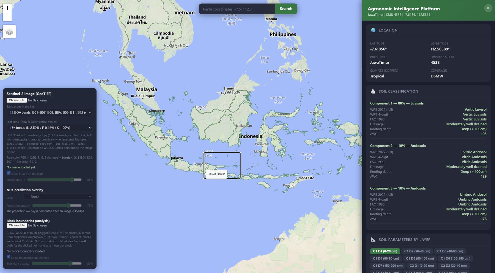

This note follows the November 2026 write-up of the Agronomic Intelligence screen. It is exploratory. It is not a peer-reviewed paper.

## Dataset and data sources

The soil class and layer properties are read from Harmonized World Soil Database version 2 (FAO/IIASA) at the clicked cell and joined to the attribute database. Historical rain is the WorldClim v2.1 monthly precipitation stack. The six-month outlook is the ECMWF SEAS5 ensemble mean from the Open-Meteo seasonal API. Province context uses GADM v4.1. A Sentinel-2 surface-reflectance GeoTIFF is optional and is supplied by the user. The Indonesia extracts of HWSD and WorldClim are not republished here.

## Method

The workflow is a lookup and a rule screen.

```text
cell = soil raster at the clicked coordinate
components = HWSD v2 attributes for that mapping unit
rain = WorldClim monthly precipitation at the cell
outlook = Open-Meteo SEAS5 ensemble mean, next six months
vpd = calculated from temperature and relative humidity
label each month against the local normal
flag infertile if a listed constraint fires for a major component or the topsoil
```

Separate ratings remain visible for pH, organic carbon, total nitrogen, CEC, base saturation, and aluminium saturation, so one fertile flag does not hide a moderate limitation. Dry months in the WorldClim year, under 60 mm, and a very wet year, over 3,000 mm, add a climate note. Recommendation text in the tool is rule-based. The equations used for an optional Sentinel-2 nutrient layer are cited, not copied: Kaliana (2018), with leaf classes from Ochs and Olivin and soil classes from Goh (2011), as named in the note.

## Result

The figure is the working interface, centred on a point in East Java. For the mapping unit in that view the sidebar reports three components, Luvisols and Andosols, with drainage, rooting depth, and available water. No regional accuracy statistic is stated in the note, so none is given here.

<figure>
  
  <figcaption>Figure. Agronomic Intelligence, November 2026. One clicked cell. Not a farm survey.</figcaption>
</figure>

## Interpretation

The screen answers a desk question: what a global soil grid and a climate series say about constraints at a coordinate, and what a Sentinel-2 image would add inside a block if one is loaded. It does not certify land suitability and it does not estimate yield.

## Limits

A mapping unit can mix several soils. The fertile flag is a personal screening rule, not an official FAO class. The seasonal notes depend on a live API. A reflectance regression is sensitive to cloud, scale, and sensor. The note says this screen should not be used alone for a sourcing or compliance decision.

## References

FAO/IIASA (2023). Harmonized World Soil Database version 2.0.

Fick, S.E. and Hijmans, R.J. (2017). WorldClim 2. International Journal of Climatology, 37, 4302–4315.

ECMWF SEAS5, accessed through the Open-Meteo Seasonal Forecast API.

GADM (2024). Database of Global Administrative Areas, version 4.1.

Kaliana, I. (2018). Development of a Decision Support System for Oil Palm Fertilizer Requirement Based on Precision Agriculture. MSc thesis, IPB University. The equations are cited, not reproduced.

Related project: Agronomic Intelligence.
