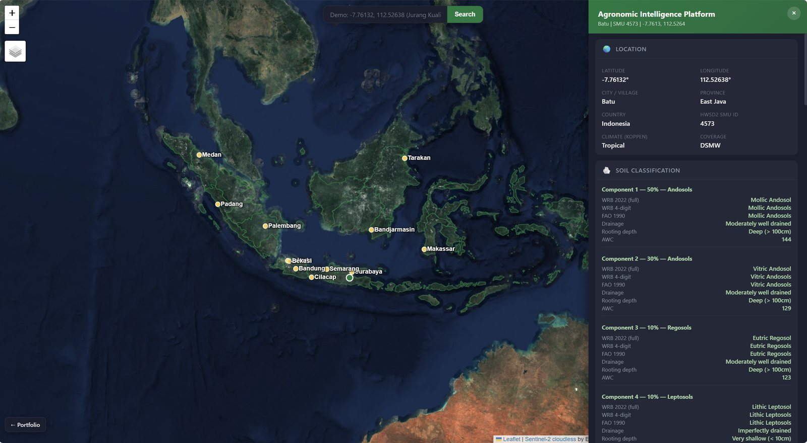

Agronomic Intelligence is a map-based tool for a quick first look at a location in Indonesia. Click a point and it returns the soil profile from the Harmonized World Soil Database (version 2), the historical rainfall from WorldClim v2.1, and a six-month outlook from the ECMWF SEAS5 ensemble through the Open-Meteo seasonal API. It also calculates vapour-pressure deficit and compares each coming month with the local normal.

The tool flags a location as fertile or infertile with a simple constraint screen. A location is marked infertile when a major soil component (at least 25 percent of the mapping unit) or the topsoil has a serious limitation: a problem soil type in the World Reference Base, very shallow rooting, very high organic carbon, coarse fragments of 60 percent or more, very poor drainage, organic carbon below 1 percent in a mineral soil, CEC below 5 cmolc kg⁻¹, pH below 4.0 or above 8.5, aluminium saturation of 60 percent or more, ESP of 25 percent or more, or EC of 8 dS m⁻¹ or more. This is a screening rule, not an FAO land-evaluation class or a yield model.

If a Sentinel-2 surface-reflectance image is loaded, the tool also estimates leaf and soil nutrients with published regressions (Kaliana, 2018). Those estimates are a guide, not a replacement for laboratory analysis.

<figure>
  
  <figcaption>The interface showing an HWSD v2 soil reading for a mapping unit in East Java. Basemap: OpenFreeMap.</figcaption>
</figure>

## Limits

The soil grid is coarse compared with a farm block, and one mapping unit can contain several soils. The seasonal outlook depends on a live forecast service. Satellite nutrient estimates shift with cloud cover, scale, and sensor. The screen is meant for an early desk assessment and should not be the only basis for sourcing or compliance decisions.
